.. _ml:

Machine learning
================

GeoWombat's ML module works with any scikit-learn compatible classifier or
pipeline. Pass a classifier to :func:`~geowombat.ml.fit`,
:func:`~geowombat.ml.predict`, or :func:`~geowombat.ml.fit_predict` and it
will be applied to the raster data as an xarray DataArray.

For satellite image time series, the module also ships
:class:`~geowombat.ml.MiniRocketClassifier`, a fast CPU time-series
classifier (see :ref:`ml-time-series`), alongside the PyTorch sequence
classifiers in :ref:`dl`. All of them check their inputs and fill gaps
before training (see :ref:`ml-data-hygiene`).

To install ML dependencies::

    pip install "geowombat[ml]"

Recommended classifiers for remote sensing
------------------------------------------

Supervised
~~~~~~~~~~

.. list-table::
   :header-rows: 1
   :widths: 25 35 40

   * - Classifier
     - Module
     - Notes
   * - Random Forest
     - ``sklearn.ensemble.RandomForestClassifier``
     - Most widely used in remote sensing; handles high-dimensional data well, robust to noise
   * - LightGBM
     - ``lightgbm.LGBMClassifier``
     - Fast gradient boosting; strong accuracy with large datasets, supports categorical features
   * - Gradient Boosted Trees
     - ``sklearn.ensemble.GradientBoostingClassifier``
     - Strong accuracy; slower than LightGBM on large datasets
   * - Support Vector Machine
     - ``sklearn.svm.SVC``
     - Effective in high-dimensional spaces; works well with small training sets
   * - Gaussian Naive Bayes
     - ``sklearn.naive_bayes.GaussianNB``
     - Fast and simple baseline; assumes feature independence
   * - k-Nearest Neighbors
     - ``sklearn.neighbors.KNeighborsClassifier``
     - Non-parametric; useful for complex class boundaries
   * - L-TAE, TempCNN, CNN-BiLSTM
     - ``geowombat.ml`` (see :ref:`dl`)
     - PyTorch sequence classifiers for satellite image time series;
       learn the temporal features end to end, GPU optional
   * - MiniRocket
     - ``geowombat.ml.MiniRocketClassifier``
     - Satellite image time series (9+ dates); fixed convolution kernels
       plus a ridge classifier, fast and CPU-only. See :ref:`ml-time-series`

Unsupervised
~~~~~~~~~~~~

.. list-table::
   :header-rows: 1
   :widths: 25 35 40

   * - Classifier
     - Module
     - Notes
   * - K-Means
     - ``sklearn.cluster.KMeans``
     - Standard clustering; fast, works well for spectrally distinct classes
   * - Mini-Batch K-Means
     - ``sklearn.cluster.MiniBatchKMeans``
     - Faster K-Means variant for large rasters
   * - Gaussian Mixture Model
     - ``sklearn.mixture.GaussianMixture``
     - Soft clustering; models class overlap better than K-Means

Setup
-----

.. code-block:: python

    import geowombat as gw
    from geowombat.data import (
        l8_224078_20200518,
        l8_224078_20200518_points,
        stac_training,
    )
    from geowombat.ml import fit, predict, fit_predict

    import geopandas as gpd
    import matplotlib.pyplot as plt
    import numpy as np
    from sklearn.pipeline import Pipeline
    from sklearn.preprocessing import LabelEncoder, StandardScaler
    from sklearn.decomposition import PCA
    from sklearn.naive_bayes import GaussianNB
    from sklearn.cluster import KMeans

    # Polygon labels (integer 'lc' column, EPSG:4326)
    labels_poly = gpd.read_file(stac_training)

    # Point labels (need LabelEncoder for string names)
    le = LabelEncoder()
    labels_point = gpd.read_file(l8_224078_20200518_points)
    labels_point['lc'] = le.fit(labels_point.name).transform(labels_point.name)
    labels_point = labels_point.drop(columns=['name'])

Nodata handling
---------------

By default, ``fit_predict()`` and ``predict()`` mask nodata pixels in the
output with NaN (``mask_nodataval=True``). This prevents nodata regions from
being assigned a class label.

When opening a file with ``gw.open(..., nodata=0)``, GeoWombat builds a
binary nodata mask from the original file *before* warping. This mask is
attached as the ``_nodata_mask`` coordinate and survives reprojection and
time-stacking. The ``_mask_nodata()`` method uses it to replace predictions
at nodata locations with NaN.

.. code-block:: python

    with gw.config.update(ref_res=150):
        with gw.open(l8_224078_20200518, nodata=0) as src:
            # _nodata_mask is automatically attached
            print('Has nodata mask:', '_nodata_mask' in src.coords)

            # mask_nodataval=True (default) masks nodata in predictions
            y = fit_predict(src, pl, labels_poly, col='lc')

To disable nodata masking, pass ``mask_nodataval=False``. This is useful
when you want to handle masking yourself or inspect raw predictions.

.. _ml-data-hygiene:

Data hygiene for time series
----------------------------

Missing values decide more than model choice. A multi-date stack usually
has gaps from clouds, shadows and scene edges, and how those gaps are
handled can move accuracy by more than the difference between two models.
Filling gaps with zeros before scaling is the most common mistake: a zero
reflectance lies far outside anything the model saw in training.

GeoWombat's time-series classifiers (``MiniRocketClassifier``,
``LTAEClassifier``, ``TempCNNClassifier``, ``CNNBiLSTMClassifier`` and
``TabNetClassifier``) therefore audit their inputs and fill gaps for you.
The recommended order is:

1. Open with the file's nodata value so scene edges are known:
   ``gw.open(files, stack_dim='time', nodata=0)``.
2. Mask clouds and shadows. ``src.gw.mask_clouds(mask)`` accepts the code
   arrays from :class:`geowombat.radiometry.QAMasker` or
   :func:`geowombat.radiometry.mask_s2`, or any boolean cloud mask, and
   tags the result so the classifiers know clouds were handled.
3. Inspect what is missing with ``src.gw.missing_report()``.
4. Fill gaps, either up front with ``src.gw.fill_time()`` or by letting the
   classifier do it (the ``fill`` option).
5. Classify.

.. code-block:: python

    from geowombat.radiometry import QAMasker
    from geowombat.ml import fit_predict, TempCNNClassifier

    with gw.open(qa_files, stack_dim='time') as qa:
        cloud = QAMasker(qa, 'hls', ['cloud', 'shadow']).to_mask()

    with gw.open(files, stack_dim='time', nodata=0) as src:
        clean = src.gw.mask_clouds(cloud)
        print(clean.gw.missing_report())
        #          time   band  n_pixels  frac_nan  frac_nodata  frac_zero  frac_missing
        # 0  2020-05-18   blue    151776     0.031          0.0        0.0         0.031
        # ...
        y = fit_predict(clean, TempCNNClassifier(seed=0), labels, col='lc')

The report has one row per time step and band. ``frac_missing`` counts NaN
and nodata; ``frac_zero`` counts exact zeros that are *not* the declared
nodata value, which usually means unmasked nodata. Pixels that are missing
in every time step and band lie outside the image footprint and are not
counted as gaps.

What the classifiers check
~~~~~~~~~~~~~~~~~~~~~~~~~~

At ``fit()`` and ``predict()`` the data is audited, and a
``GeoWombatInputWarning`` is issued when:

- a time step or band has more than 5% missing values;
- exact zeros appear in a band and zero is not the nodata value;
- at ``predict()``, a time step is missing far more often than it was in
  the training data (the model never saw gaps there, so those predictions
  rest on the fill);
- a stack of three or more dates has no gaps at all and was never tagged as
  cloud masked, which usually means clouds were not masked. Silence this by
  masking with ``src.gw.mask_clouds()`` or, if the data really is clean,
  ``src.attrs['cloud_masked'] = True``.

A time step that is entirely missing in the training data raises an error:
drop it (``src.isel(time=...)``) or use ``fill='interpolate'``.

Every time-series classifier takes two hygiene options:

- ``audit``: ``'warn'`` (default), ``'raise'`` to turn findings into
  errors, or ``'off'``. The audit reads the raster once before
  ``predict()`` builds its lazy prediction graph, so on very large stacks
  ``predict()`` does one full pass up front; ``audit='off'`` skips it.
- ``fill``: how gaps are filled before scaling.

.. list-table::
   :header-rows: 1
   :widths: 22 60

   * - ``fill``
     - Behaviour
   * - ``'train_median'`` (default)
     - Per band and time step median of the training raster, stored on the
       classifier and reused at ``predict()``. No prediction-time statistic
       is ever used.
   * - ``'interpolate'``
     - Linear interpolation along time per pixel; the ends take the nearest
       valid value. Pixels with no valid value stay NaN.
   * - ``'zero'``
     - Legacy behaviour; warns. Only for reproducing old results.
   * - ``'none'``
     - No filling. ``fit()`` raises if labelled pixels contain gaps.

Pixels that cannot be filled, and pixels that are nodata in every time
step, are NaN in the prediction. They are never predicted from zeros.

To silence the warnings selectively:

.. code-block:: python

    import warnings
    from geowombat.core.timeseries import GeoWombatInputWarning

    warnings.simplefilter('ignore', GeoWombatInputWarning)

Supervised classification
-------------------------

Using ``fit()`` then ``predict()`` (two-step)
~~~~~~~~~~~~~~~~~~~~~~~~~~~~~~~~~~~~~~~~~~~~~

.. code-block:: python

    pl = Pipeline([
        ('scaler', StandardScaler()),
        ('pca', PCA()),
        ('clf', GaussianNB()),
    ])

    with gw.config.update(ref_res=150):
        with gw.open(l8_224078_20200518, nodata=0) as src:
            X, Xy, clf = fit(src, pl, labels_poly, col='lc')
            y = predict(src, X, clf)
            y.plot(robust=True)

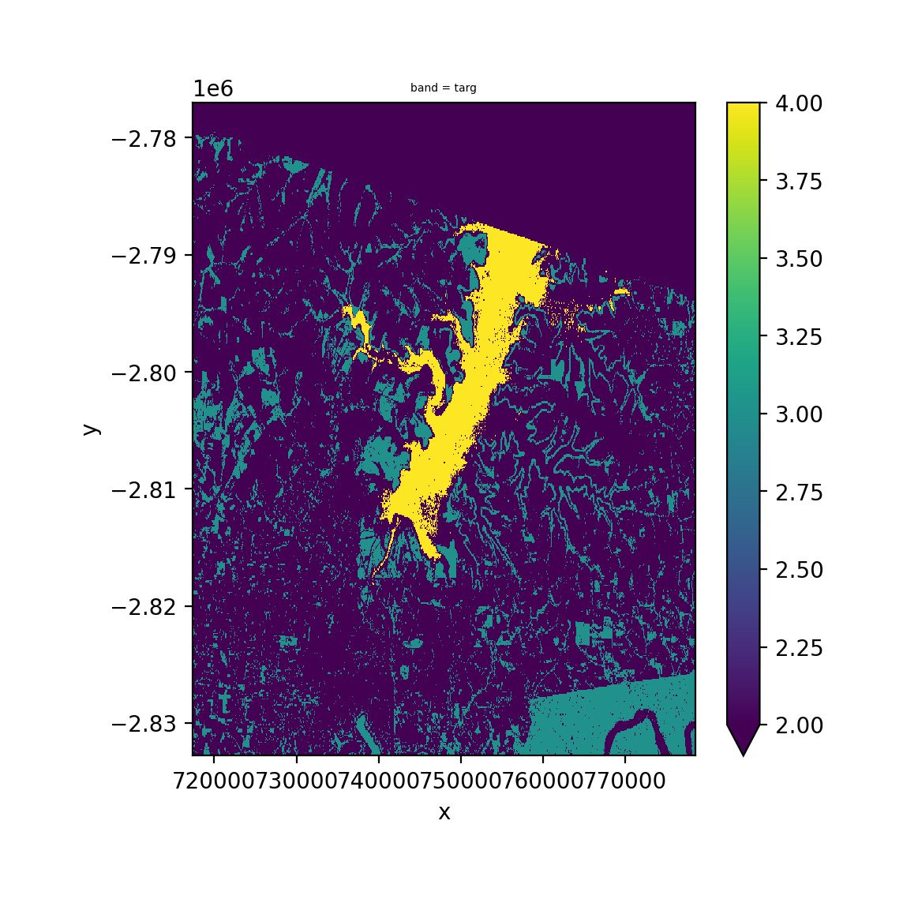

Using ``fit_predict()`` (one-step)
~~~~~~~~~~~~~~~~~~~~~~~~~~~~~~~~~~

.. code-block:: python

    with gw.config.update(ref_res=150):
        with gw.open(l8_224078_20200518, nodata=0) as src:
            y = fit_predict(src, pl, labels_poly, col='lc')
            y.plot(robust=True)

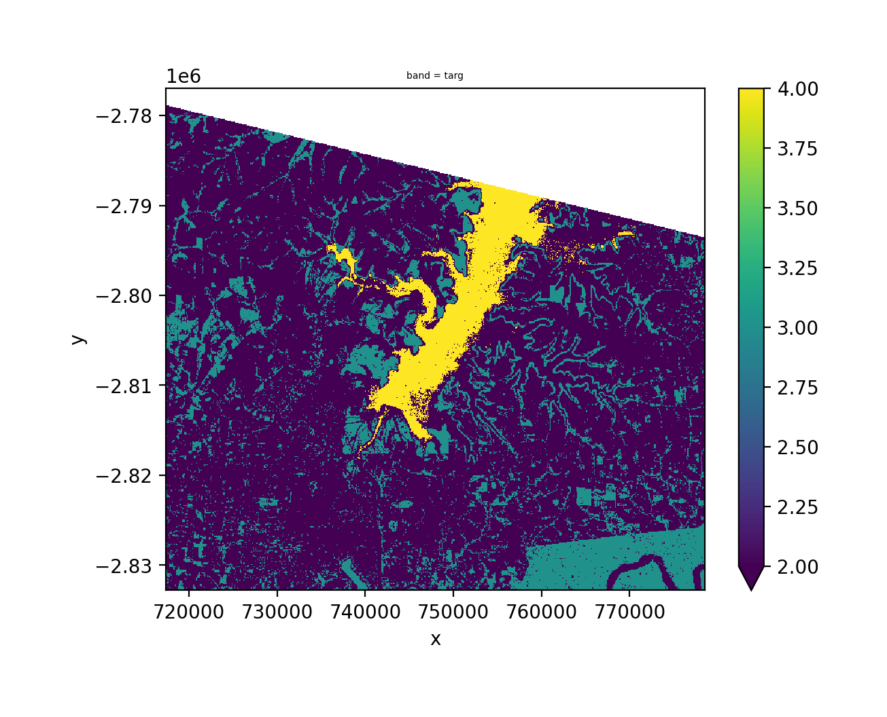

Unsupervised classification (KMeans)
-------------------------------------

No training labels needed. The algorithm identifies clusters directly from
the pixel values.

.. code-block:: python

    cl = Pipeline([('clf', KMeans(n_clusters=6, random_state=0))])

    with gw.config.update(ref_res=150):
        with gw.open(l8_224078_20200518, nodata=0) as src:
            y = fit_predict(src, cl)
            y.plot(robust=True)

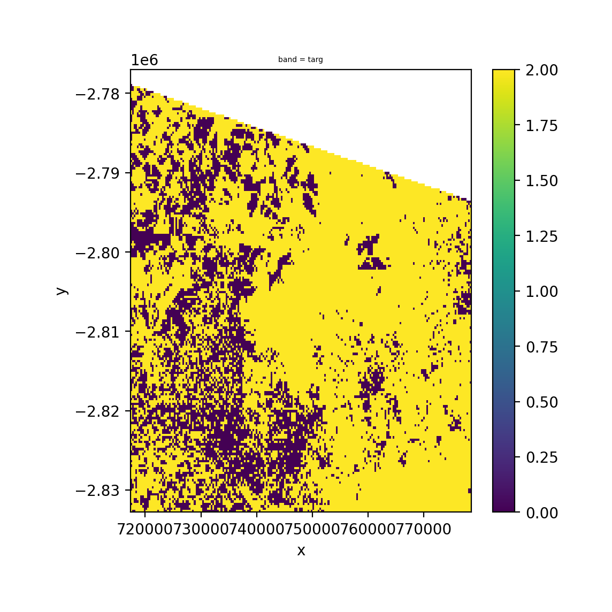

Band-stacked classification
-----------------------------

Stack multiple images along the band dimension with ``stack_dim='band'``.
This concatenates spectral bands from each date into one long feature vector
per pixel.

.. code-block:: python

    with gw.config.update(ref_res=150):
        with gw.open(
            [l8_224078_20200518, l8_224078_20200518],
            stack_dim='band',
            nodata=0,
        ) as src:
            print('Band-stacked shape:', src.shape)
            y = fit_predict(src, pl, labels_poly, col='lc')
            y.plot(robust=True)

.. image:: _static/ml_unsupervised_fit_predict.png
   :width: 500px
   :alt: Band-stacked classification

Cross-validation and hyperparameter tuning
-------------------------------------------

Use ``GridSearchCV`` with ``CrossValidatorWrapper`` to tune pipeline
hyperparameters.

.. code-block:: python

    from sklearn.model_selection import GridSearchCV, KFold
    from sklearn_xarray.model_selection import CrossValidatorWrapper

    cv = CrossValidatorWrapper(KFold())
    gridsearch = GridSearchCV(
        pl,
        cv=cv,
        scoring='balanced_accuracy',
        param_grid={
            'scaler__with_std': [True, False],
            'pca__n_components': [1, 2, 3],
        },
    )

    with gw.config.update(ref_res=150):
        with gw.open(l8_224078_20200518, nodata=0) as src:
            X, Xy, pipe = fit(src, pl, labels_poly, col='lc')

            gridsearch.fit(*Xy)
            print('Best params:', gridsearch.best_params_)

            pipe.set_params(**gridsearch.best_params_)
            y = predict(src, X, pipe)
            y.plot(robust=True)

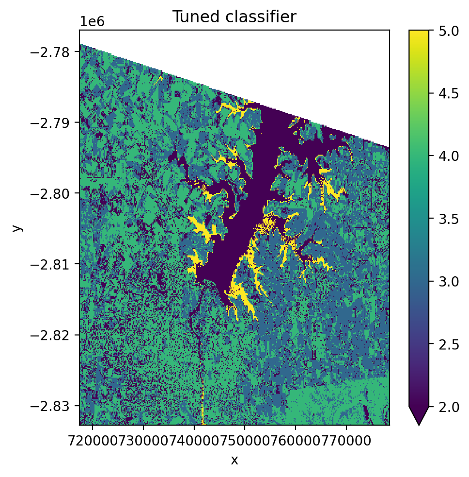

Time-stacked classification with ``temporal_mode``
---------------------------------------------------

When opening multiple images with ``stack_dim='time'``, the data has shape
``(time, band, y, x)``. This is the format returned by STAC queries and
multi-date ``gw.open()`` calls. The ``temporal_mode`` parameter controls how
time is handled during classification:

- ``'panel'`` (default) — each pixel-time is an independent sample with B
  spectral features. Output retains the time dimension with one prediction
  per time step.
- ``'flatten'`` — all time steps are flattened into the band dimension,
  creating T×B features per pixel. Output has no time dimension.

.. list-table::
   :header-rows: 1
   :widths: 25 15 15 30

   * - Input
     - ``temporal_mode``
     - Features
     - Output shape
   * - ``(time=T, band=B, y, x)``
     - ``'panel'``
     - B
     - ``(time=T, band='targ', y, x)``
   * - ``(time=T, band=B, y, x)``
     - ``'flatten'``
     - T × B
     - ``(band='targ', y, x)``

.. note::

   The scikit-learn path does not audit or fill missing values. Mask clouds
   and fill gaps first (``src.gw.mask_clouds()``, ``src.gw.fill_time()``),
   or use one of the time-series classifiers, which do this for you; see
   :ref:`ml-data-hygiene`.

Panel mode
~~~~~~~~~~

Each pixel-time combination is treated as an independent sample. The output
retains the time dimension, giving one prediction map per time step. Nodata
pixels are masked automatically (``mask_nodataval=True`` by default).

.. code-block:: python

    pl_panel = Pipeline([
        ('scaler', StandardScaler()),
        ('pca', PCA()),
        ('clf', GaussianNB()),
    ])

    with gw.config.update(ref_res=150):
        with gw.open(
            [l8_224078_20200518, l8_224078_20200518],
            stack_dim='time',
            nodata=0,
        ) as src:
            y_panel = fit_predict(
                src, pl_panel, labels_point, col='lc',
                temporal_mode='panel',
            )

    print(f'Shape: {y_panel.shape}')  # (2, 1, 372, 408)
    print(f'Dims:  {y_panel.dims}')   # ('time', 'band', 'y', 'x')

    # Since both time steps use the same image, predictions should match
    print('Time steps identical:',
          np.allclose(y_panel.isel(time=0).values,
                      y_panel.isel(time=1).values, equal_nan=True))

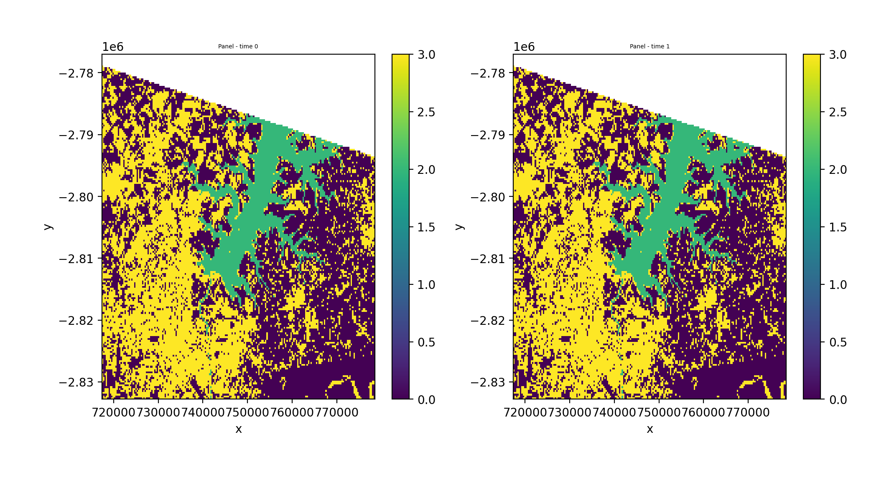

Flatten mode
~~~~~~~~~~~~

All time steps are flattened into the band dimension, creating T×B features
per pixel. This produces a single prediction map regardless of how many
time steps exist.

.. code-block:: python

    pl_flatten = Pipeline([
        ('scaler', StandardScaler()),
        ('pca', PCA(n_components=1)),
        ('clf', GaussianNB()),
    ])

    with gw.config.update(ref_res=150):
        with gw.open(
            [l8_224078_20200518, l8_224078_20200518],
            stack_dim='time',
            nodata=0,
        ) as src:
            y_flat = fit_predict(
                src, pl_flatten, labels_point, col='lc',
                temporal_mode='flatten',
            )

    print(f'Shape: {y_flat.shape}')  # (1, 372, 408)
    print(f'Dims:  {y_flat.dims}')   # ('band', 'y', 'x')

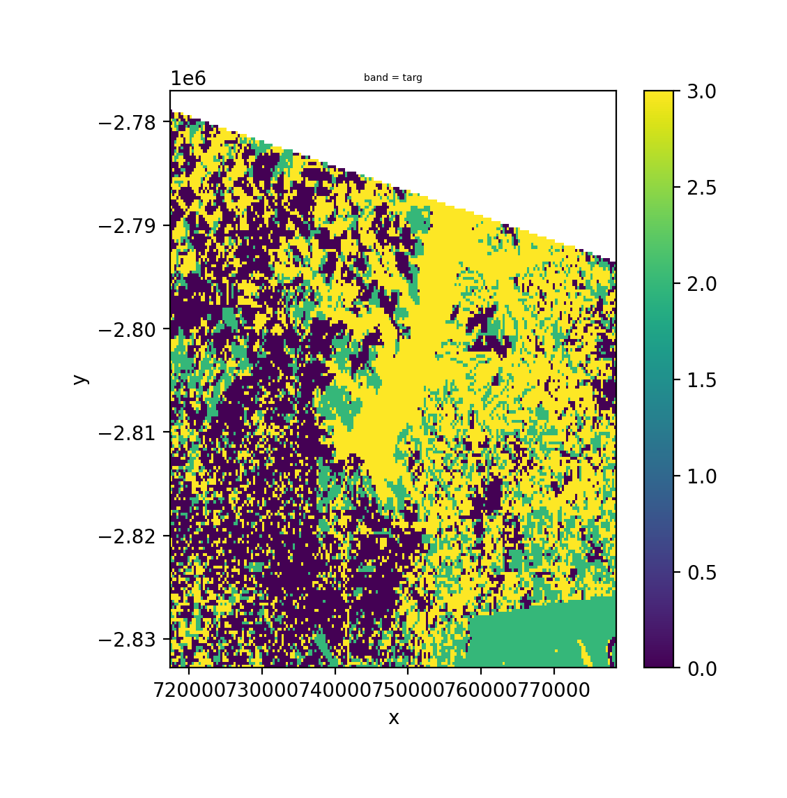

Unsupervised clustering with time-stacked data
~~~~~~~~~~~~~~~~~~~~~~~~~~~~~~~~~~~~~~~~~~~~~~~

.. code-block:: python

    cl_time = Pipeline([
        ('scaler', StandardScaler()),
        ('clf', KMeans(n_clusters=4, random_state=0)),
    ])

    with gw.config.update(ref_res=150):
        with gw.open(
            [l8_224078_20200518, l8_224078_20200518],
            stack_dim='time',
            nodata=0,
        ) as src:
            y_cl = fit_predict(
                data=src, clf=cl_time,
                temporal_mode='panel',
            )

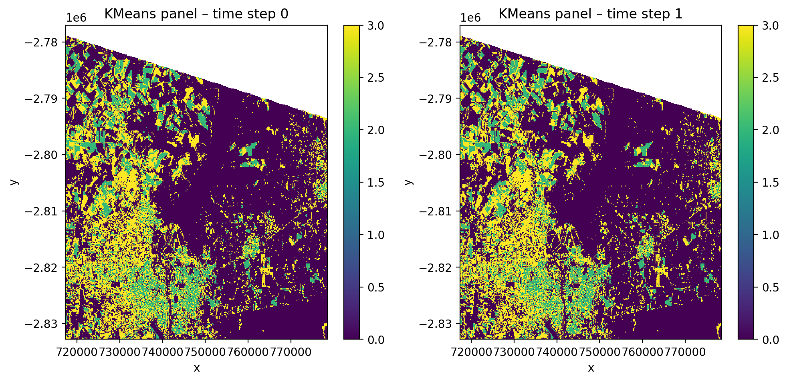

Compare panel vs flatten
~~~~~~~~~~~~~~~~~~~~~~~~

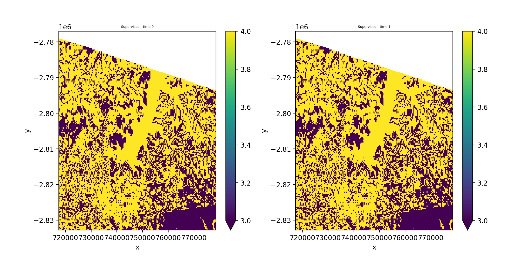

.. _ml-time-series:

Time series classifiers
-----------------------

There are three ways to classify ``(time, band, y, x)`` stacks:

- ``temporal_mode='flatten'`` (above) turns the T×B values of each pixel
  into one feature vector and hands it to any scikit-learn model. The model
  sees the dates as independent columns.
- :class:`~geowombat.ml.MiniRocketClassifier` keeps the series structure of
  each pixel (``band`` × ``time``) and extracts ~10,000 convolutional
  features from it before a linear classifier.
- The PyTorch sequence classifiers ``LTAEClassifier``,
  ``TempCNNClassifier`` and ``CNNBiLSTMClassifier`` (see :ref:`dl`) learn
  the temporal features end to end.

All of them audit their inputs and fill gaps before training; see
:ref:`ml-data-hygiene`.

MiniRocket (Dempster, Schmidt and Webb, 2021) applies 84 fixed dilated
convolution kernels of length 9 to each series and records the proportion
of positive values for a set of random biases. It is almost deterministic,
trains in seconds on a CPU, needs no GPU, and is a strong baseline for
per-pixel classification of multi-date imagery such as crop phenology. See
the `paper <https://arxiv.org/abs/2012.08791>`_ and the `original repository
<https://github.com/angus924/minirocket>`_. GeoWombat uses the BSD-licensed
implementation in `aeon <https://www.aeon-toolkit.org/>`_, a port of the
original code made with the authors' permission.

**Requires** multi-temporal data with a ``time`` dimension (open with
``stack_dim='time'``) and at least 9 time steps. It is installed with the
``ml`` extra::

    pip install "geowombat[ml]"

How it works:

- Each pixel's ``(band, time)`` series is transformed with MiniRocket,
  scaled with ``StandardScaler``, and classified with ``estimator``
  (default ``RidgeClassifierCV``). Any scikit-learn classifier can be
  swapped in.
- Training uses the pixels covered by the label polygons or points.
- Prediction runs lazily, block by block, transforming ``batch_size``
  pixels at a time to bound memory.
- Inputs are audited and gaps are filled before the transform (training
  medians by default); see :ref:`ml-data-hygiene`.

Key parameters:

- ``n_kernels``: number of kernels, rounded down to a multiple of 84
  (default 10,000)
- ``max_dilations_per_kernel``: dilations per kernel (default 32)
- ``estimator``: scikit-learn classifier fitted on the MiniRocket
  features (default ``RidgeClassifierCV(alphas=np.logspace(-3, 3, 10))``)
- ``class_weight``: ``'balanced'`` or a dict, for the default ridge only
- ``max_train_samples``: cap on the number of labeled pixels used for
  training (default: all)
- ``batch_size``: pixels transformed at once during prediction
  (default 2048; peak memory per block is about
  ``batch_size × n_kernels × 4`` bytes)
- ``n_jobs``: threads for the transform (``-1`` for all cores)
- ``random_state``: seed for the kernel biases and subsampling
- ``audit`` and ``fill``: input checks and gap filling, see
  :ref:`ml-data-hygiene`

MiniRocket fit_predict with time-stacked data
~~~~~~~~~~~~~~~~~~~~~~~~~~~~~~~~~~~~~~~~~~~~~

.. code-block:: python

    from geowombat.ml import fit_predict, MiniRocketClassifier

    # One file per acquisition date; the list order is the time order
    with gw.config.update(ref_res=150):
        with gw.open(
            [l8_224078_20200518] * 9,   # demo only: 9 copies of one date
            stack_dim='time',
            nodata=0,
        ) as src:
            print(src.dims)  # ('time', 'band', 'y', 'x')
            # Nine copies of one date have no cloud gaps and no cloud
            # mask, so the audit would warn; tag the demo stack. With real
            # imagery, mask clouds instead (src.gw.mask_clouds()).
            src.attrs['cloud_masked'] = True
            y = fit_predict(
                src,
                MiniRocketClassifier(n_kernels=2000, random_state=42),
                labels_point,
                col='lc',
            )

    print(f'Shape: {y.shape}')  # (1, 372, 408)
    print(f'Dims:  {y.dims}')   # ('band', 'y', 'x')
    y.gw.save('minirocket_lc.tif')

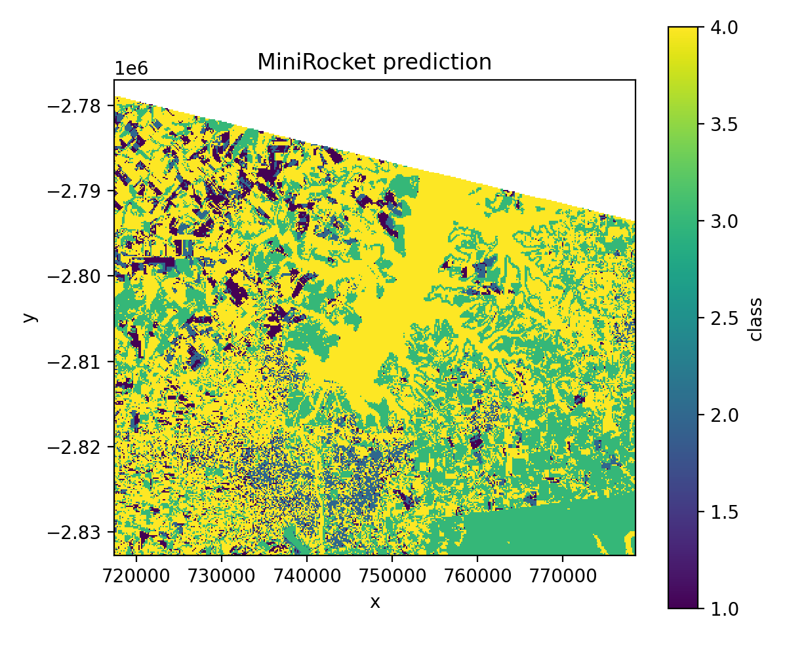

.. note::

   This demo stacks the same image nine times to satisfy the minimum
   series length. In practice, use imagery from different acquisition
   dates: MiniRocket is most useful when the temporal profile differs
   between classes (e.g. crop phenology vs. forest).

MiniRocket: separate fit then predict
~~~~~~~~~~~~~~~~~~~~~~~~~~~~~~~~~~~~~

.. code-block:: python

    with gw.config.update(ref_res=150):
        with gw.open(
            [l8_224078_20200518] * 9,
            stack_dim='time',
            nodata=0,
        ) as src:
            clf = MiniRocketClassifier(n_kernels=2000, random_state=42)
            X, Xy, clf = fit(src, clf, labels_point, col='lc')
            y = predict(src, X, clf)

The fitted model only predicts stacks with the same number of bands and
time steps it was trained on, because the MiniRocket features depend on
the series length.

Swapping the estimator
~~~~~~~~~~~~~~~~~~~~~~

MiniRocket is a feature extractor; the final classifier is any
scikit-learn model. Use ``estimator`` when you need class probabilities,
class weights on a non-ridge model, or a tree ensemble on the extracted
features:

.. code-block:: python

    from sklearn.linear_model import LogisticRegression

    clf = MiniRocketClassifier(
        n_kernels=2000,
        estimator=LogisticRegression(max_iter=500, class_weight='balanced'),
        random_state=42,
    )

Errors
~~~~~~

MiniRocket raises a clear error when the data is missing the ``time``
dimension or has too few dates:

.. code-block:: python

    with gw.open(l8_224078_20200518, nodata=0) as src:
        fit(src, MiniRocketClassifier(), labels_point, col='lc')
    # ValueError: MiniRocketClassifier.fit() requires multi-temporal data
    # with a 'time' dimension (time, band, y, x). Open data with
    # stack_dim='time'.

    with gw.open([l8_224078_20200518] * 2, stack_dim='time') as src:
        fit(src, MiniRocketClassifier(), labels_point, col='lc')
    # ValueError: MiniRocketClassifier requires at least 9 time steps;
    # found 2.

Classification with STAC satellite imagery
--------------------------------------------

GeoWombat can stream satellite imagery directly from cloud catalogs using
``open_stac()``. The returned data has shape ``(time, band, y, x)`` and works
directly with ``fit_predict()``. No file downloads are needed — data is read
from Cloud Optimized GeoTIFFs (COGs) on the fly.

To install STAC dependencies::

    pip install "geowombat[stac]"

Search and load imagery
~~~~~~~~~~~~~~~~~~~~~~~

Use ``open_stac()`` to search a STAC catalog and load the matching scenes.
Set ``compute=True`` to download the data into memory with a progress bar.

.. code-block:: python

    from geowombat.core.stac import open_stac

    # Search for Sentinel-2 imagery over Washington, DC
    data, df = open_stac(
        stac_catalog="element84_v1",
        collection="sentinel_s2_l2a",
        bounds=(-77.1, 38.85, -76.95, 38.95),
        epsg=32618,
        bands=["blue", "green", "red", "nir"],
        start_date="2023-06-01",
        end_date="2023-07-31",
        cloud_cover_perc=20,
        resolution=100.0,
        chunksize=256,
        max_items=2,
        compute=True,
    )

    print(f"Shape: {data.shape}")   # (2, 4, 115, 134)
    print(f"Dims:  {data.dims}")    # ('time', 'band', 'y', 'x')

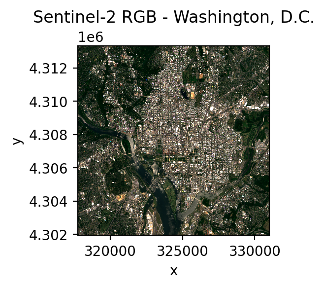

Unsupervised classification on a single STAC image
~~~~~~~~~~~~~~~~~~~~~~~~~~~~~~~~~~~~~~~~~~~~~~~~~~~

Select one time step with ``.isel(time=0)`` and pass it directly to
``fit_predict()``. No training labels are needed for unsupervised classifiers.

.. code-block:: python

    from sklearn.cluster import MiniBatchKMeans

    cl_stac = Pipeline([
        ("clf", MiniBatchKMeans(n_clusters=5, random_state=0)),
    ])

    single_image = data.isel(time=0)
    y_single = fit_predict(data=single_image, clf=cl_stac)
    y_single.plot(robust=True)

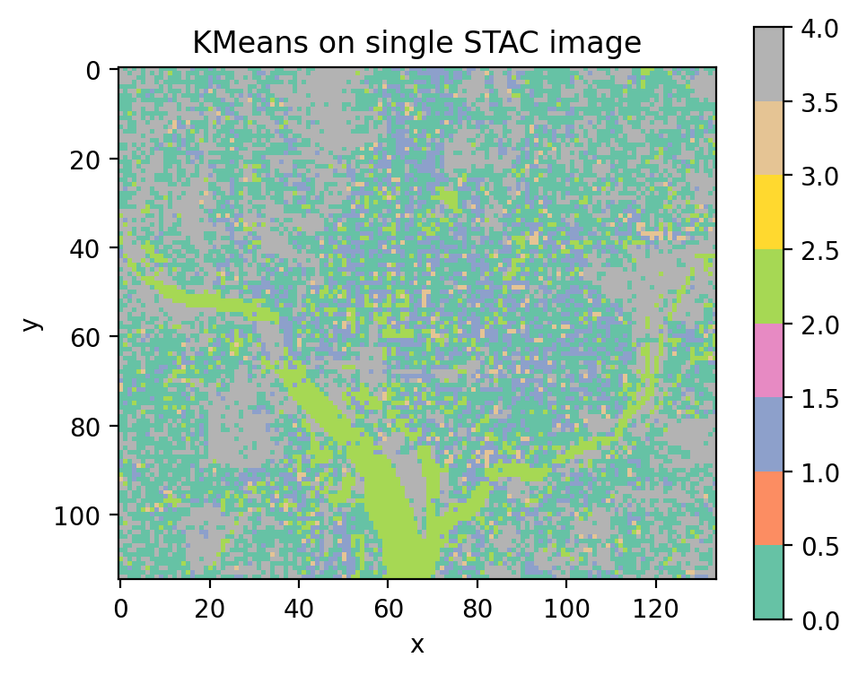

Save prediction output
----------------------

.. code-block:: python

    y.gw.save('output.tif', overwrite=True)
